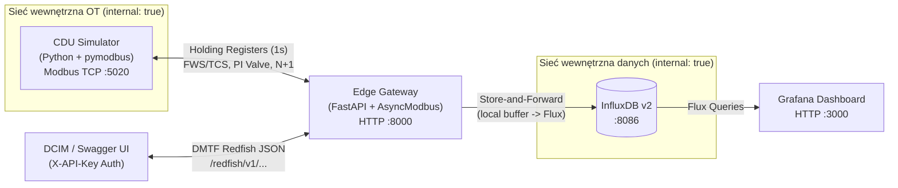

# DCX CDU Digital Twin – Edge Gateway & DMTF Redfish PoC

Skonteneryzowany prototyp oprogramowania brzegowego (IPC/Edge) dla przemysłowej jednostki dystrybucji chłodziwa (**CDU** – *Coolant Distribution Unit*) stosowanej w centrach danych AI/HPC.

Projekt łączy warstwę automatyki OT (**Modbus TCP**), buforowanie i bazę szeregów czasowych (**InfluxDB v2**), wizualizację (**Grafana**) oraz integrację z infrastrukturą Data Center poprzez standard **DMTF Redfish REST API**, z uwzględnieniem izolacji sieci i dobrych praktyk bezpieczeństwa **IEC 62443**.

> **Demo wideo:** *(Przeciągnij tutaj swoje nagranie `.mp4` w edytorze GitHuba i usuń tę linijkę)*

---

## Architektura i izolacja sieci

Warstwa obiektowa (`cdu-simulator`) oraz baza danych (`influxdb`) działają wyłącznie w odizolowanych sieciach wewnętrznych Dockera (`internal: true`) i **nie są wystawione na zewnątrz**. Cały ruch sterujący i odczytowy z zewnątrz przechodzi wyłącznie przez uwierzytelnioną bramkę `edge-gateway` lub `grafana`.



---

## Główne funkcje

* **Realistyczny model fizyki CDU (`cdu_simulator`):**
  * Dwa obiegi cieczy oddzielone wymiennikiem ciepła: pierwotny **FWS** (*Facility Water System*) i wtórny **TCS** (*Technology Cooling System*).
  * Bezwładność termiczna, przyrost temperatury $\Delta T$ zależny od obciążenia serwerów (`it_load_kw`) oraz przepływu (`flow_lpm`), a także regulator **PI** sterujący zaworem pierwotnym FWS (`0–100%`).
  * Logika redundancji pomp **N+1** (automatyczne przejęcie pracy przez `Pump2` przy awarii `Pump1`) oraz obsługa **krytycznej awarii obu pomp naraz** (spadek przepływu do `0 L/min`, szybki wzrost temperatury powrotu, alarm krytyczny).
* **Bramka brzegowa (`edge_gateway`):**
  * Asynchroniczny kolektor **Modbus TCP** (`pymodbus`) z automatycznym wznawianiem połączenia.
  * Lokalne buforowanie (*store-and-forward*, kolejka w pamięci do 600 próbek) na wypadek chwilowej niedostępności InfluxDB.
  * **REST API zgodne ze standardem DMTF Redfish** (`/redfish/v1/ThermalEquipment/CDUs/1` wraz z akcjami `SetTargetTemperature` oraz `SimulatePumpFault`).
* **Bezpieczeństwo (OT / IEC 62443):**
  * Pełna izolacja sieciowa Modbusa (`5020`) i InfluxDB (`8086`) w sieciach `internal: true`.
  * Autoryzacja endpointów Redfish kluczem `X-API-Key` (porównanie `secrets.compare_digest` odporne na *timing attack*).
  * Nagłówki bezpieczeństwa HTTP (`X-Content-Type-Options: nosniff`, `Cross-Origin-Resource-Policy: same-origin`, `X-Frame-Options: DENY`).
  * Kontenery uruchamiane jako użytkownik bez uprawnień (`USER appuser`), `cap_drop: ALL`, `no-new-privileges: true`.
  * Brak sekretów w kodzie aplikacji — konfiguracja przez zmienne środowiskowe / `.env` (wzór w `.env.example`).

---

## Szybkie uruchomienie

1. *(Opcjonalnie)* skopiuj plik konfiguracyjny i ustaw własne hasła/klucze:
   ```bash
   cp .env.example .env
   ```
   *(Jeśli pominiesz ten krok, `docker-compose.yml` użyje bezpiecznych lokalnie wartości domyślnych z suffixem `dcx-local-...`).*

2. Zbuduj i uruchom cały stos:
   ```bash
   docker compose up -d --build
   ```

3. Sprawdź status połączenia z symulatorem i bazą:
   * **Healthcheck:** http://localhost:8000/health
   * **Grafana (Dashboard na żywo):** http://localhost:3000/d/dcx-cdu-overview
     *(domyślny login: `admin` / `dcx-local-grafana-pass`)*
   * **Redfish API (Swagger UI):** http://localhost:8000/docs
     *(kliknij **Authorize** i podaj klucz `dcx-local-redfish-key`)*

---

## Scenariusz Demo (Testy N+1 i sterowania)

1. Otwórz dashboard w Grafanie (`http://localhost:3000/d/dcx-cdu-overview`) i ustaw zakres na **Last 5 minutes** oraz odświeżanie **5s**.
2. W Swaggerze (`http://localhost:8000/docs`) kliknij **Authorize** i wklej `dcx-local-redfish-key`.
3. **Failover N+1:** wywołaj `POST /redfish/v1/ThermalEquipment/CDUs/1/Actions/SimulatePumpFault` z:
   ```json
   { "pump1_fault": true, "pump2_fault": false }
   ```
   `Pump2` natychmiast przejmuje obciążenie, przepływ jest utrzymany, a status zmienia się na `PUMP1 FAILOVER (N+1)`.
4. **Całkowita utrata przepływu:** wywołaj ten sam endpoint z:
   ```json
   { "pump1_fault": true, "pump2_fault": true }
   ```
   Przepływ spada do `0 L/min`, temperatura `tcs_return_temp_c` zaczyna szybko rosnąć, a system zgłasza alarm krytyczny `CRITICAL_BOTH_PUMPS_FAULT` (`Status.Health: Critical` w Redfish). Przywróć układ wysyłając `false / false`.
5. **Zmiana nastawy:** wywołaj `POST .../Actions/SetTargetTemperature` z `{"target_temp_c": 26.0}` i obserwuj płynną krzywą regulacji z bezwładnością termiczną wymiennika.

---

## Testy, skany bezpieczeństwa i CI/CD

Projekt posiada potok **GitHub Actions** (`.github/workflows/ci.yml`) uruchamiający testy jednostkowe/integracyjne (`pytest`), analizę statyczną SAST (`bandit`) oraz weryfikację budowania obrazów (`docker compose build`).

**Uruchomienie testów w kontenerze:**
```bash
docker compose run --rm --no-deps -u root edge-gateway sh -c "pip install -q pytest httpx && PYTHONPATH=. pytest -v"
```

**Przykładowe skany bezpieczeństwa wykonane lokalnie:**
* **OWASP ZAP (DAST OpenAPI scan):** `FAIL-NEW: 0`, `WARN-NEW: 0`
  ```bash
  docker run --rm -t zaproxy/zap-stable zap-api-scan.py -t http://host.docker.internal:8000/openapi.json -f openapi
  ```
* **Aqua Trivy (skan zależności i konfiguracji):**
  ```bash
  docker run --rm -v "${PWD}:/src" aquasec/trivy:latest fs --scanners vuln,misconfig,secret /src
  ```